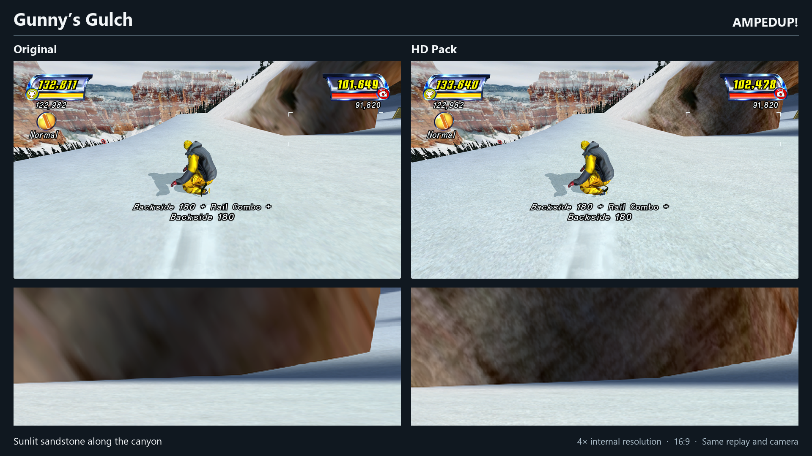
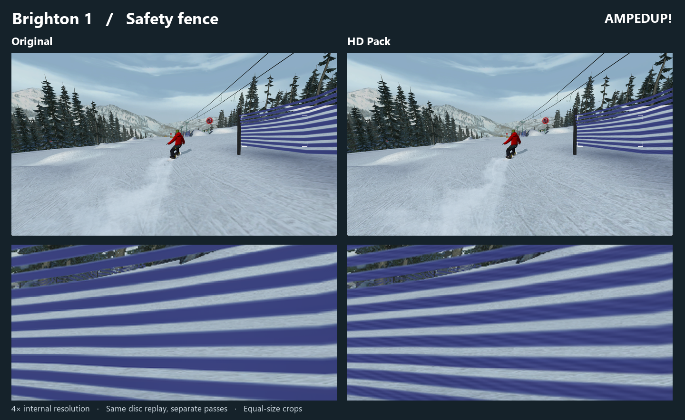
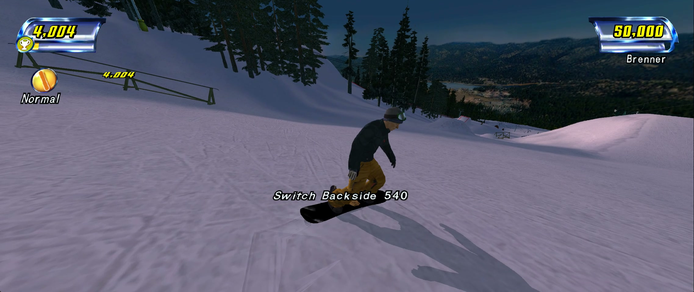
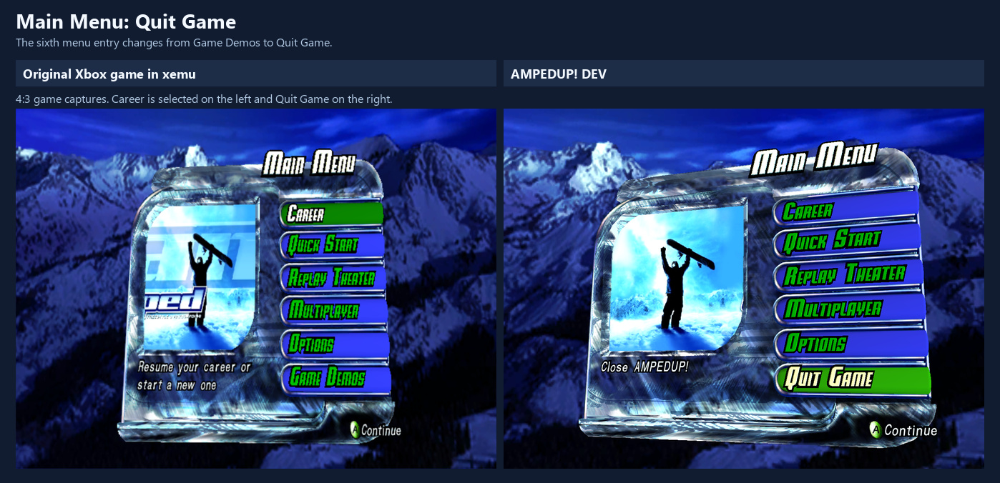

# AMPEDUP! 0.8.3

An unofficial static recompilation of the original Xbox version of *Amped: Freestyle Snowboarding* for Windows x64. It runs the original courses, physics, music and menus using data from your own disc, with optional **21:9 ultrawide gameplay**.

<a href="https://recomplauncher.com/game/ampedup"><picture><source media="(prefers-color-scheme: dark)" srcset="https://recomplauncher.com/assets/press/launcher/badge-light.svg"></picture></a>

[Download for Windows](https://github.com/AMPEDUP-2001/AMPEDUP/releases/latest) · [System requirements](#system-requirements) · [Build from source](docs/building.md) · [Release notes](docs/release-0.8.3.md) · [HD comparison gallery](docs/screenshots/hd-pack/README.md) · [Credits](#credits)

**On a slower PC?** Open **Options → Graphics → Potato Mode**, switch it on and confirm the restart. If you already use Potato Mode, updating applies the CPU improvements to your current preset. You can turn it off to restore your graphics settings.

**Choppy while riding?** In **Options → Graphics**, try **Fullscreen On**, **Match fullscreen Hz On**, **VSync On** and a **60 FPS cap**. The game uses a supported refresh rate and restores your desktop rate when you leave fullscreen.

## Original and 0.8 HD Pack

These are in-game captures at 4× internal resolution. Original is on the left and the optional HD Pack is on the right. Each inset shows the same part of the scene at the same scale.

[See all 15 comparison shots, including Snow Summit in 21:9, and the silent Brighton lift clip](docs/screenshots/hd-pack/README.md).

## Play on Windows

Choose a Windows installer from the [0.8.3 release](https://github.com/AMPEDUP-2001/AMPEDUP/releases/tag/v0.8.3).

- **Online** downloads the build tools during setup. [Setup-AMPEDUP-0.8.3-Online.exe](https://github.com/AMPEDUP-2001/AMPEDUP/releases/download/v0.8.3/Setup-AMPEDUP-0.8.3-Online.exe)
- **All-in-one** includes the build tools and installs offline. [Setup-AMPEDUP-0.8.3.exe](https://github.com/AMPEDUP-2001/AMPEDUP/releases/download/v0.8.3/Setup-AMPEDUP-0.8.3.exe)

1. Open the installer you downloaded.
2. Choose your matching XISO, a new installation folder, and whether to create a desktop shortcut.
3. Click **Install**. Setup checks the paths, sizes and SHA-256 hashes of all 610 retail files as it extracts them, then compiles the game on your PC. The build takes several minutes, plus download time with the online installer.
4. Start `AMPEDUP!.exe` from the shortcut or the installation folder. Choose **Game language**, then **Play**. The European release supports English, Deutsch, Français, Italiano and Español. RecompLauncher offers the same choice in the game's settings.

Use your own European multilingual retail disc image. The standalone installers above also accept a rebuilt XISO when it contains the same 610 retail files. Keep the original executables intact when converting or repacking. The reference image has SHA-256 `1DCAF6F4C5385B90987A0DB33CBC34ED408982995DFE3A5B68DCFAD70CA91CB0`. Other disc editions remain unverified. The repository contains the runtime, patch recipes and build tools. Bring your own disc to generate the executable and install game content.

For RecompLauncher, use the Windows x64 ZIP and select the reference XISO or the extracted folder containing `default.xbe` in Easy Setup. Setup downloads the build tools and compiles the game locally. Play opens the game directly and settings, saves, and logs live under `profile/` in the ZIP's installation folder. See [launcher setup details](docs/building.md#package-for-recomplauncher).

## System requirements

- Windows 10 or 11 x64 and a Vulkan-capable GPU with a compatible driver.
- About 6 GB of free disk space for extraction and temporary build files.
- The matching retail XISO listed above. Internet access is required for the online installer.

**Original benchmark PC.** Windows 11 Pro, Intel Core i7-8700K (6 cores, 12 threads), NVIDIA GeForce RTX 3070 (8 GB VRAM), and 48 GB RAM. Minimum CPU, GPU, and RAM requirements are still unverified.

### Performance on the test PC

The development benchmark measured two 30-second gameplay samples per scale on **Snow Summit 1 / Miracle Mile**. It used Vulkan with VSync, a 1706 × 960 widescreen window on a 2560 × 1440 display at roughly 60 Hz, a 60 FPS cap, SMAA, 16× anisotropic filtering, CRT off, and muted audio.

| Internal scale | Avg. displayed FPS | Mean CPU draw | GPU busy (p95) | GPU budget left (p95) |
| --- | ---: | ---: | ---: | ---: |
| 1× | 56.22 | 7.43 ms (44.6%) | 8.65 ms (51.9%) | 48.1% |
| 2× | 58.15 | 6.56 ms (39.4%) | 8.84 ms (53.1%) | 46.9% |
| 3× | 58.52 | 6.48 ms (38.9%) | 9.18 ms (55.1%) | 44.9% |
| 4× | 58.50 | 6.37 ms (38.2%) | 9.56 ms (57.3%) | 42.7% |

The percentages use the 16.67 ms frame budget for 60 FPS. CPU draw measures rendering work on the CPU, and GPU busy measures active GPU time using PresentMon. CPU and GPU work can overlap. The slowest five-second window at 4× averaged 55.94 displayed FPS.

**0.8 HD Pack on the upgraded PC.** An Intel Core i5-12600K, RTX 3070 and 32 GB RAM ran the same 18-second section of the Snow Summit 2 *Air Addict* replay four times. Settings were fullscreen 16:9 on a 100 Hz display, 4×, SMAA, 16× filtering, a 60 FPS cap, CRT off and muted audio. Original averaged 59.91 and 59.92 displayed FPS. The HD Pack averaged 59.92 and 59.94. All four samples had a 99th-percentile display interval near 20.05 ms and zero intervals over 25 ms. With HD enabled, the 95th-percentile GPU busy time was 7.25–8.65 ms, leaving 48–56% of a 60 FPS frame budget in this section.

## Game features

- Vulkan rendering, 4:3 and native 16:9, and internal resolution from original through 4×.
- **21:9 ultrawide** widens the course camera, anchors the score HUD near the corners, and keeps menus centered. Turn on **Options → Graphics → Ultrawide (21:9)** and confirm the restart. In RecompLauncher, choose **21:9** under **Aspect ratio** before launching.
- FXAA, SMAA, anisotropic filtering, and optional CRT scanlines.
- Xbox controller and keyboard support with tested Quick Start, Career saving and replay playback.
- Open **Options → Graphics** or press **F1** or **View + Menu**. The Audio tab has speaker mode, two mixes, and soundtrack, effects and master levels, and spatial width.
- **Quit Game** replaces **Game Demos** on the Main Menu. Settings that need a restart ask for confirmation.
- Choose **Options → Graphics → Course textures** and confirm the restart. **Original** (the default) uses the disc textures. **HD Pack** adds close-up detail to selected snow, wood, bark, and metal. Look for grain in Stratton's wooden A-frame supports and shallow scrapes in the quarterpipe snow at Gunny's Gulch. Groomed snow keeps the disc's track marks and shading as the camera moves into the distance. On Snow Summit, nearby pine boughs also carry finer needle detail. Distant trees use the original course mipmaps.
- At Gunny’s Gulch, the HD Pack brings out fine sandstone grain along the canyon wall. Both comparisons show the same disc replay at 4×. [Sandstone beside the rail](docs/screenshots/hd-pack/gunnys-gulch-sandstone-rail.png) · [Sunlit canyon rock](docs/screenshots/hd-pack/gunnys-gulch-sandstone-sunlit.png)
- The HD Pack adds close-up grain to the rough powder used on all 11 courses and to the snow on quarterpipe sidewalls. The original slope shading comes from the disc. [Altibahn powder](docs/screenshots/hd-pack/altibahn-shared-powder.png) · [Gunny’s Gulch powder](docs/screenshots/hd-pack/gunnys-gulch-shared-powder.png) · [Quarterpipe snow](docs/screenshots/hd-pack/gunnys-gulch-quarterpipe-snow.png)
- Miracle Mile has rounder rail and funbox details and restored snowboard powder. Brighton 1 / Hawkeye has targeted flicker fixes at Molly’s Lodge.

## Custom soundtracks

1. Open **Options → Soundtracks** and press **Y** on a controller or **Ctrl** on the keyboard.
2. Choose a folder containing MP3, FLAC, WAV, or Ogg Vorbis tracks. Each folder adds one genre.
3. Choose **Yes** to restart now or **No** to load the new genre the next time you start the game.
4. Open Soundtracks, press **X** to enable the new genre, then **A** to accept. Use **Save As Defaults** in Options to keep your selection.

Imports use the Windows Media components and save converted copies in your local profile. The import keeps existing genres, and short tracks below the game's encoded size minimum are skipped.

## 0.7.2 widescreen HUD

[Watch the same Brighton 1 replay in 4:3, 16:9, and 21:9](https://github.com/AMPEDUP-2001/AMPEDUP/releases/download/v0.7.2/AMPEDUP-0.7.2-Aspect-Ratio-Comparison.mp4) · [See what changed](docs/release-0.7.2.md)

## Menus and visual upgrades

See the [0.7.1 release notes and comparisons](docs/release-0.7.1.md) for board powder, rails, HD textures, and the Brighton window fix.

## Credits

The original game and its assets belong to their respective rights holders. AMPEDUP! is a fan project. The runtime and recompiler are based on [xboxrecomp](https://github.com/sp00nznet/xboxrecomp) and the Windows work in [Takedawn](https://github.com/xenophobentx/takedawn). The bulk dispatcher adapts [WNBDEV's pushbuffer work](https://github.com/WNBDEV/xboxrecomp/commit/83357acac82d6a82f2aeefd2888f670a4fd4bc2b). Disc repacking was tested with [extract-xiso](https://github.com/XboxDev/extract-xiso). See the vendored [licence](Amped-Host/toolkit/LICENSE) and [third-party notices](Amped-Host/toolkit/NOTICE) for component credits and terms.

Projects consulted or supplied for reference include [Burnout 3](https://github.com/sp00nznet/burnout3), [SSX3-recomp](https://github.com/koenhendriks/SSX3-recomp), [rePOP](https://github.com/FulGerNet/rePOP), [Finest Hour Remastered](https://github.com/crazyriddler/FinestHourRemastered), [RE-Amped2](https://github.com/Nico-D-eu/RE-Amped2), and [Amped 3 Revamped](https://github.com/minty-hippo/amped3revamped).

The toolkit documentation also draws on [the upstream toolkit fork](https://github.com/apexJCL/xboxrecomp), [N64Recomp](https://github.com/N64Recomp/N64Recomp), [XenonRecomp](https://github.com/hedge-dev/XenonRecomp), and [ps3recomp](https://github.com/sp00nznet/ps3recomp).
