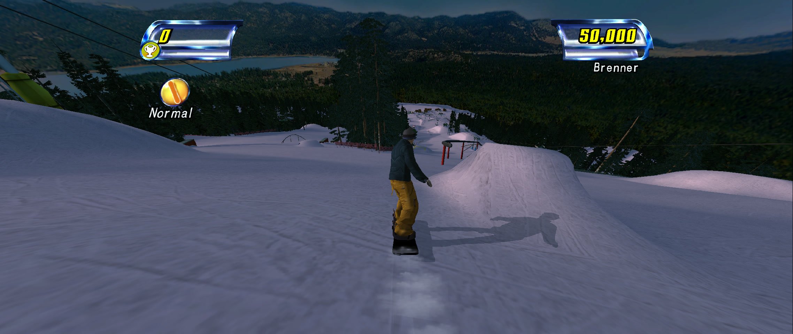
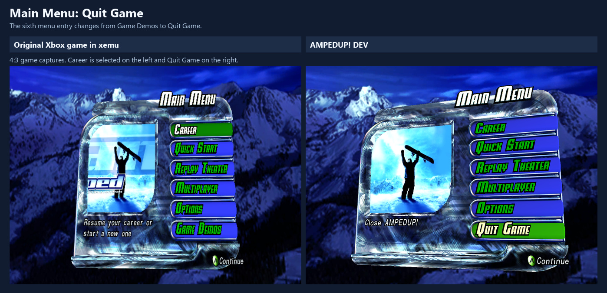
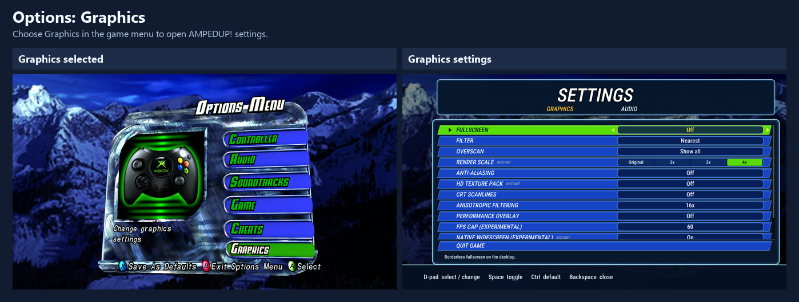
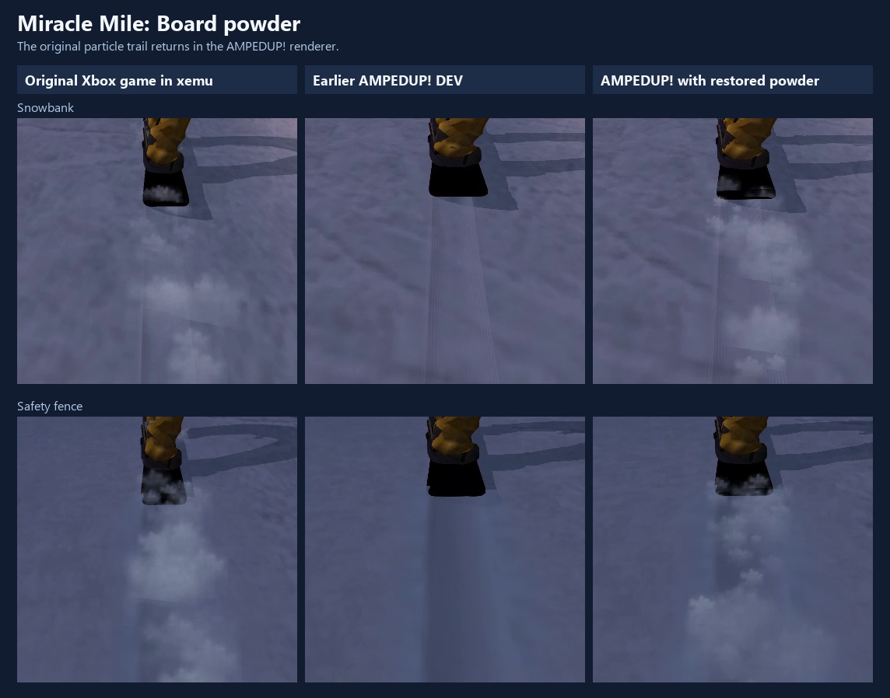
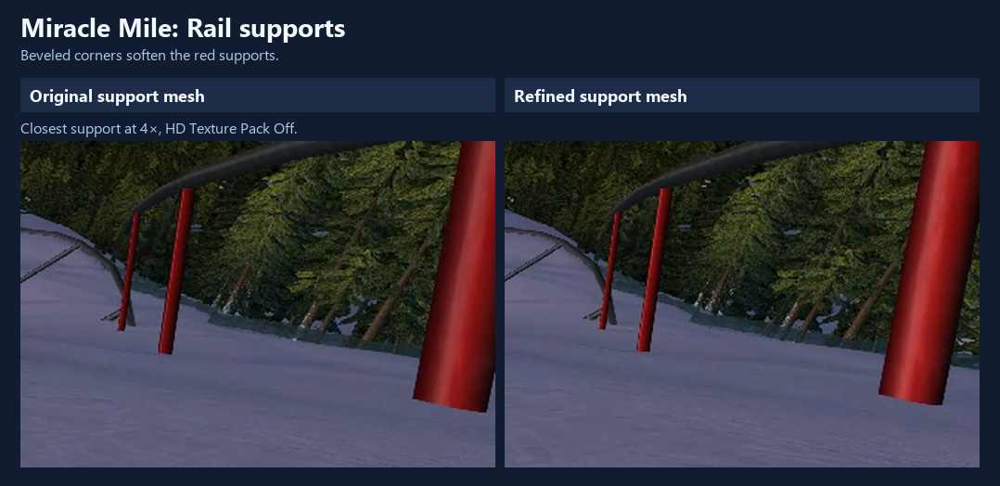
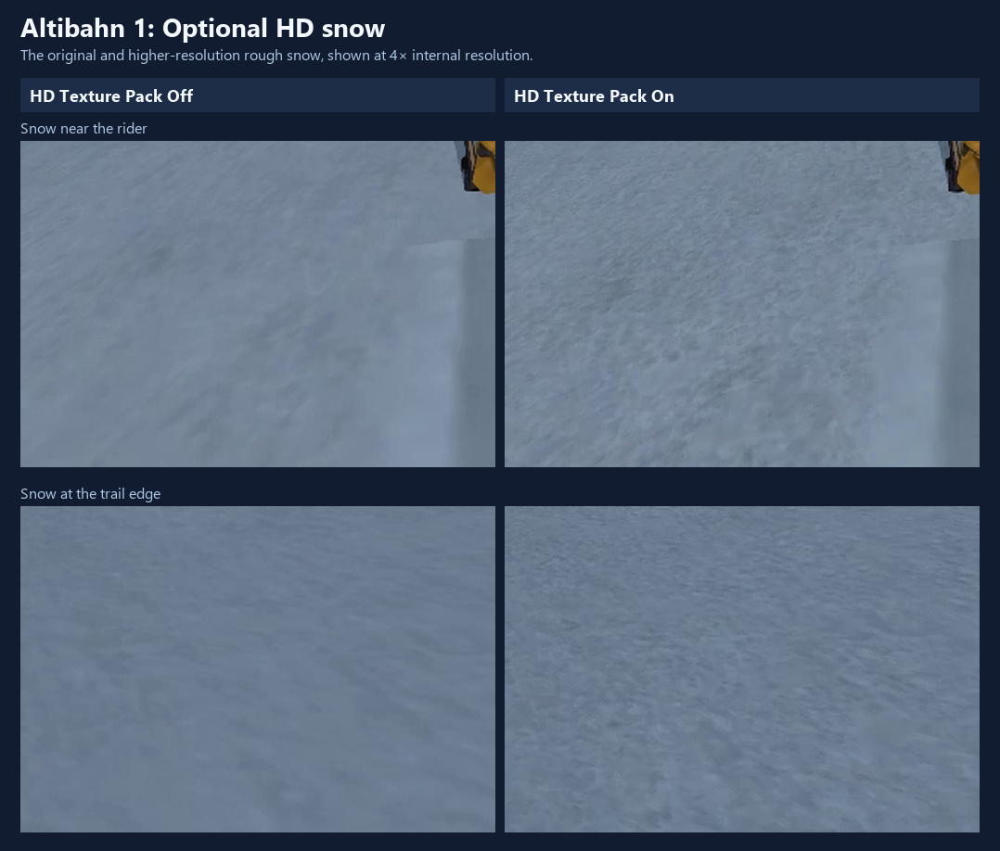
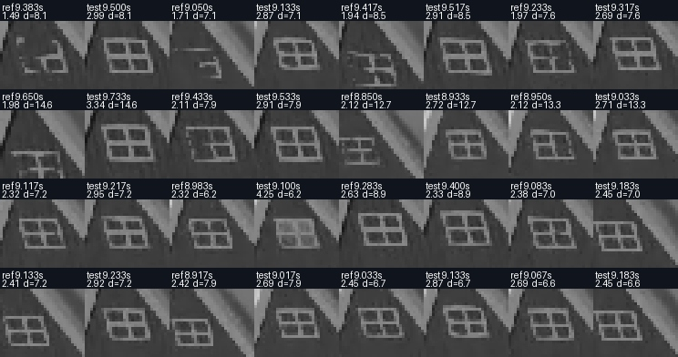

# AMPEDUP! 0.7.1

## What's new

- **Native menu entries.** Open **Options → Graphics** from the game's animated 3D menu. **Quit Game** takes the former **Game Demos** slot on the Main Menu and asks for confirmation.
- **More detail on Miracle Mile.** The opening steel pipe is rounder, its red supports have beveled corners, and the long silver funbox trim has a smoother edge. The original grind path and collision are preserved.
- **The original board powder is back.** The snowboard kicks up the original translucent powder trail as you ride, alongside the existing board tracks and shadow.
- **Optional HD textures.** **Options → Graphics → HD Texture Pack** adds close-up detail to selected snow, pine bark, and metal materials while retaining their original colors and distant mip levels. The pack starts Off and applies after a confirmed restart. Coverage is concentrated on Snow Summit 1, with a shared rough-snow material also verified on Altibahn 1.

- **Less flicker at Molly’s Lodge.** The glass, door, and small gable window at the Brighton 1 / Hawkeye finish use local depth corrections to prevent overlapping surfaces from alternating in front of each other.
- **HD Texture Pack in RecompLauncher.** The launcher exposes the same Off/On choice as the in-game Graphics menu. The default is Off.

The gable crops alternate pairs. Each reference crop is followed by a crop with the trim correction. The other comparison images use game captures from the original Xbox game in xemu or the identified AMPEDUP! builds. Camera positions, rider poses, and menu animation can vary between runs.

## What you can play and configure

- **Quick Start, Career, and replays.** Controller testing covered downhill runs and results, Career creation and progress through a restart, replay recording and playback, and Xbox controller vibration. Keyboard controls are also available.
- **Graphics.** Vulkan rendering at Original, 2×, 3×, and 4× internal resolution. Choose 4:3 or native 16:9, along with FXAA or SMAA, anisotropic filtering, optional CRT scanlines, and a 60 FPS cap.
- **21:9 ultrawide.** A wider course camera with a centered HUD and menus. Enable **Options → Graphics → Ultrawide (21:9)** and confirm the restart, or choose **21:9** under **Aspect ratio** in RecompLauncher before launching.
- **Audio.** Choose Console-style or Legacy mixing, speaker layout, spatial width, and separate soundtrack, effects, and master volume. The Brighton 1 Drop Point soundtrack fix is included.
- **Your music.** From **Options → Soundtracks**, press **Y** on a controller or **Ctrl** on the keyboard to add a folder. It appears as its own genre after restart, and you can toggle it alongside the original genres. Import supports MP3, FLAC, WAV, and Ogg Vorbis.
- **Windows setup.** Choose the online installer, the all-in-one installer, or Easy Setup in RecompLauncher. Setup verifies the supported European multilingual retail XISO and generates the updated menus, rail geometry, and texture pack from your game files. RecompLauncher rebuilds the runtime during the update and keeps the settings and saves in your profile.

In DEV, the native menu was checked at 4× in 4:3, 16:9, and 21:9. A full 4× Miracle Mile controller run with HD textures Off reached results after testing the rail grind. The logged 4× HD On/Off runs on Miracle Mile were near the 60 FPS cap over the measured section. Frame rates vary by route and system.
