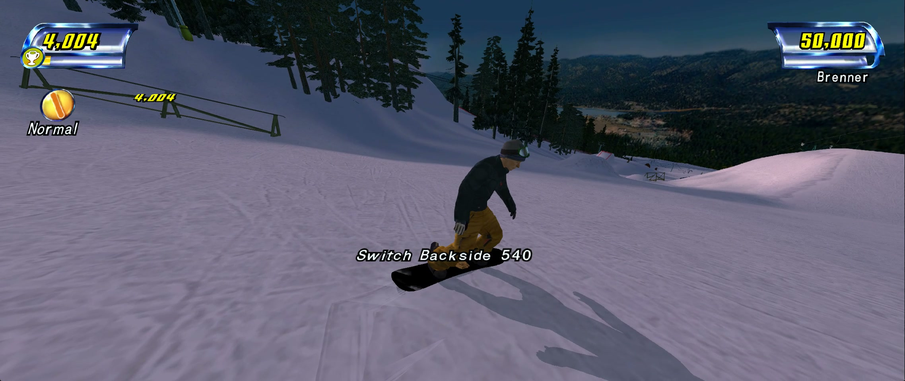
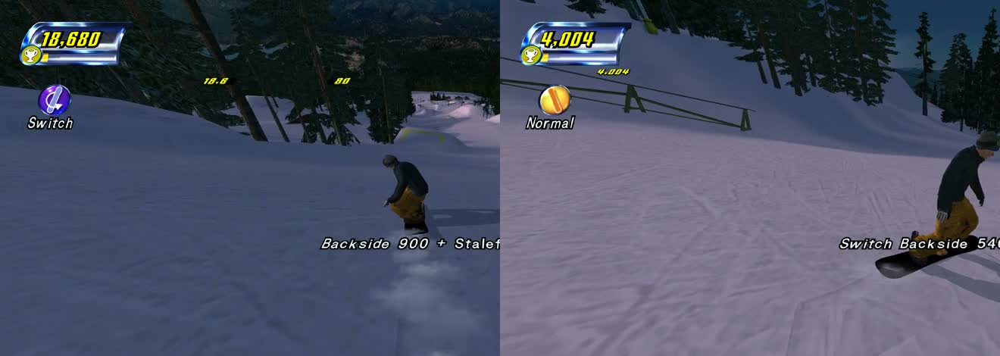
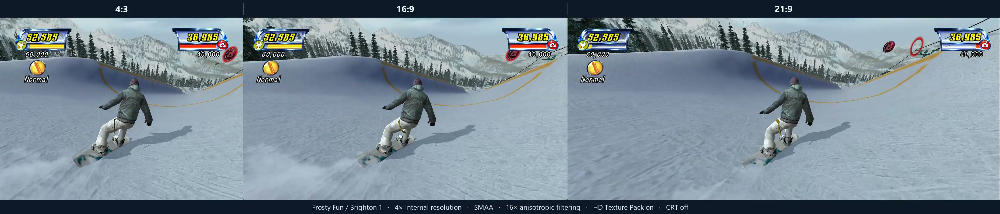

# AMPEDUP! 0.7.2

## Widescreen HUD fixes

- At 16:9 and 21:9, the score panels sit closer to the screen corners. The player score, target score, rival name, and stance icon are fully visible at 21:9.
- Earned points now animate as one number into the upper-left score tray at 21:9. The digits keep their spacing as they travel.
- The original 4:3 HUD layout is preserved. Menus stay centered at 21:9.

## Replay comparison

Watch the same **Frosty Fun** replay from **Brighton 1** side by side in **4:3, 16:9, and 21:9**. Each view uses 4× internal resolution, SMAA, 16× anisotropic filtering, the HD Texture Pack, and a 60 FPS cap. CRT scanlines are off. The comparison is silent.

[Download the comparison video](https://github.com/AMPEDUP-2001/AMPEDUP/releases/download/v0.7.2/AMPEDUP-0.7.2-Aspect-Ratio-Comparison.mp4)

The static HUD and the new scoring animation were checked on Snow Summit 1 / Miracle Mile at 4×. The [0.7.1 notes](release-0.7.1.md) cover the native menus, HD texture pack, snowboard powder, rail geometry, and Brighton lodge fixes included in this release.

## Install

Choose the [online installer, all-in-one installer, or RecompLauncher ZIP](https://github.com/AMPEDUP-2001/AMPEDUP/releases/tag/v0.7.2). Setup uses your supported European multilingual retail XISO and builds the runtime from your copy. RecompLauncher setup version 7 rebuilds the runtime with the HUD changes and keeps the profile.
