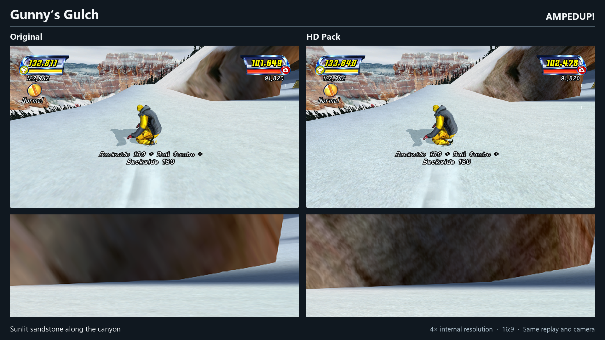
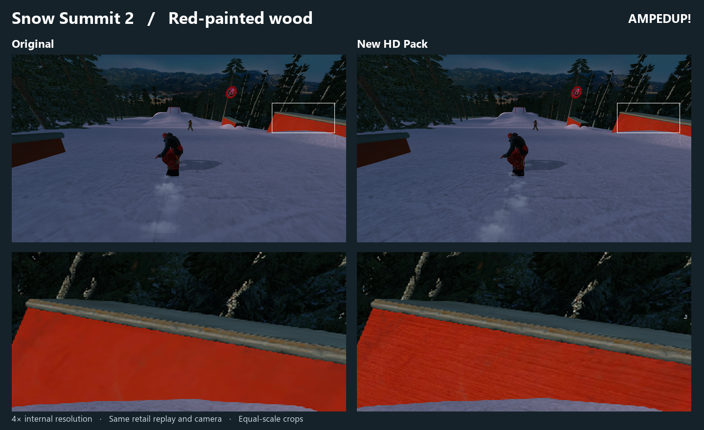
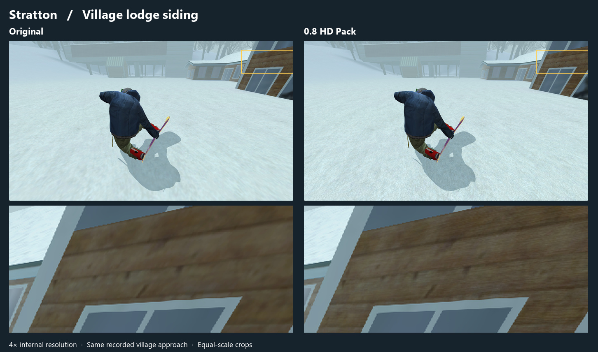

# AMPEDUP! 0.8 · The optional HD Pack

Switch between **Original** and **HD Pack** in **Options → Graphics → Course textures**, then confirm the restart. Original is the default. The HD Pack adds surface detail close to the rider while keeping the colors, track marks and distant textures from your disc.

## What you’ll see

- **Snow.** Rough powder shared by all 11 courses gains wind-worked grain. Look at the edge of the groomed slope on Altibahn or the packed sidewall of the quarterpipe at Gunny’s Gulch.
- **Wood, rock and foliage.** Red-painted funboxes show the grain under their paint, the canyon walls at Gunny’s Gulch pick up sandstone grain, and nearby pine boughs on Snow Summit show finer needles.
- **Stratton village.** As you ride past the lodge windows, the siding now shows fine horizontal grain. The darker plank joints still come from the disc.
- **Course hardware.** Brighton’s blue safety fence and the Nixon JibFest finish net have visible weave. The green lift steel keeps its original rust and paint wear.
- **Board spray.** Fresh powder lifts from the edge of the snowboard during a turn. The effect follows the game’s existing particles. The track, collision and scoring still come from the original game.

[Open the comparison gallery](screenshots/hd-pack/README.md) for the full-size views, detail crops and a silent Brighton lift clip.

## Installing or updating

Choose the **Online** Windows installer to download the build tools during setup, or **All-in-one** to install offline. Both verify the 610 game files from your own supported European multilingual XISO. A repacked XISO is accepted when its files match. RecompLauncher also accepts the extracted game folder. The in-game languages are English, Deutsch, Français, Italiano and Español.

RecompLauncher rebuilds the runtime for this release. Your profile holds your settings, career saves, replays and imported music separately from the compiled game. If a launcher update was interrupted while swapping runtimes, setup can recover a single identifiable previous installation on retry.

The 4× screenshots demonstrate the visual changes. Frame pacing varies with the course, display mode and PC.
