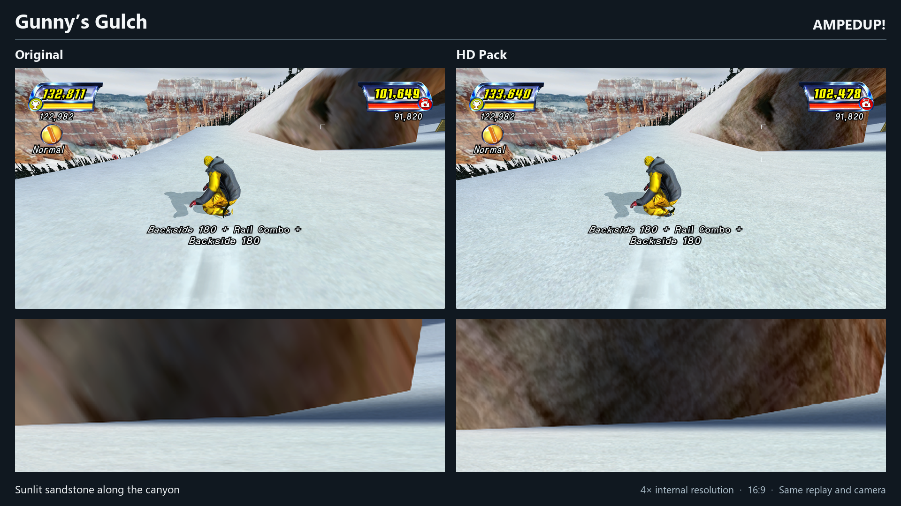
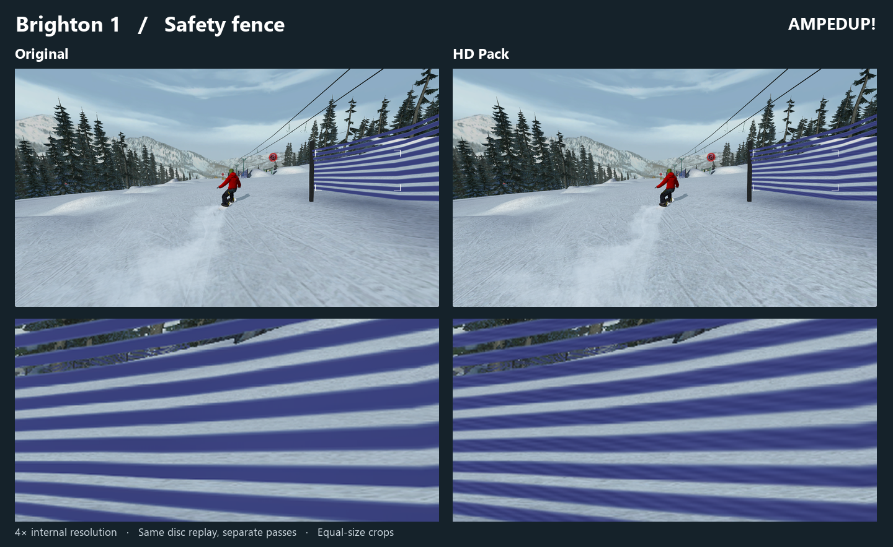
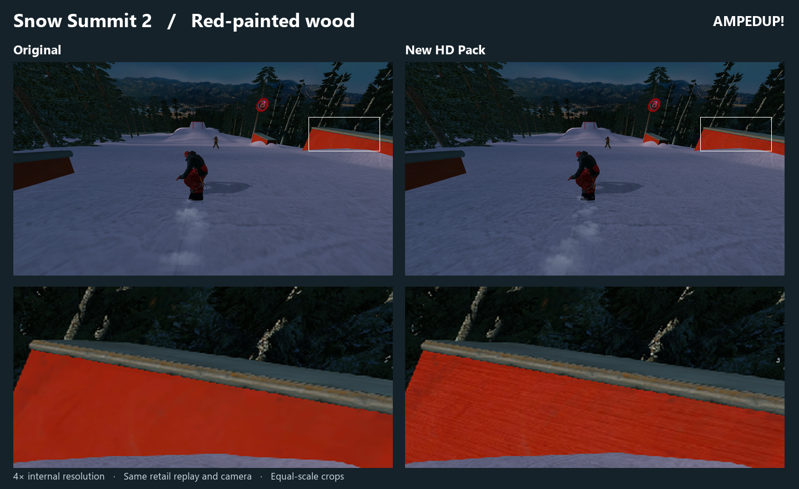
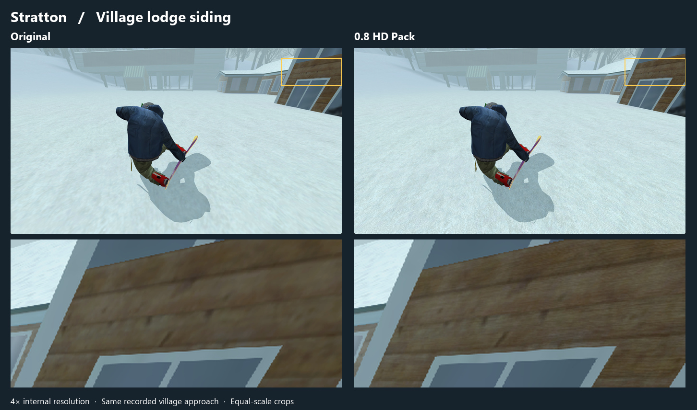
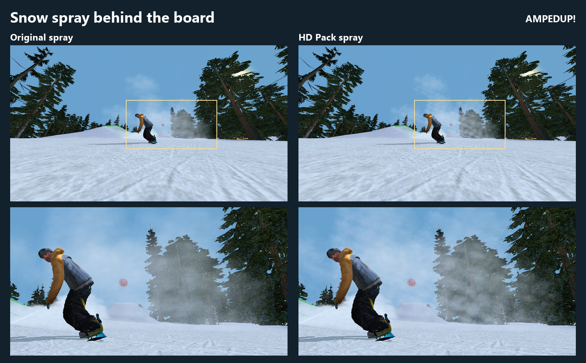

# AMPEDUP! 0.8 HD Pack comparisons

Both sides run AMPEDUP! at 4× internal resolution. **Original** uses the textures from the player's disc. **HD Pack** uses the optional graphics setting. The wide views show what you see while riding. Open an image at full size to inspect the detail crops.

### Gunny’s Gulch · Sunlit sandstone

The canyon wall keeps its bands of light and dark rock. The close view shows the grain along the sunlit face.

### Brighton 1 · Woven safety fence

The blue bands on the original fence remain visible across the slope. At close range the HD Pack brings out the individual threads.

### Snow Summit 2 · Painted funbox

The grain runs along the red boards. The paired crop shows it best on the side facing the rider.

### Stratton · Village lodge siding

Watch the building on the rider's right. The close view shows grain following the horizontal boards. The comparison uses a recorded approach through the village in both modes.

### Nixon JibFest · Board spray

Snow leaving the board stays visible against the track during a turn. The first comparison starts with Original. The second isolates the final adjustment against an earlier HD effect.

[Earlier HD spray and the revised board edge](nixon-jibfest-board-edge.png)

### More course details

| Course | Comparison |
| --- | --- |
| Altibahn 2 | [Wind-worked powder](altibahn-shared-powder.png) |
| Brighton | [Weathered paint on the lift](brighton-lift-paint.jpg) · [Lift in motion, silent](brighton-lift-paint-motion.mp4) · [Safety-net posts](brighton-shared-charcoal.png) |
| Gunny’s Gulch | [Packed snow at the quarterpipe](gunnys-gulch-quarterpipe-snow.png) · [Canyon wall beside the rail](gunnys-gulch-sandstone-rail.png) · [Rough powder](gunnys-gulch-shared-powder.png) |
| Nixon JibFest | [Woven finish net](nixon-jibfest-finish-net.png) · [Painted obstacle](nixon-jibfest-painted-obstacle.png) |

Choose **Options → Graphics → Course textures → HD Pack** and confirm the restart. A fresh installation starts in Original.
